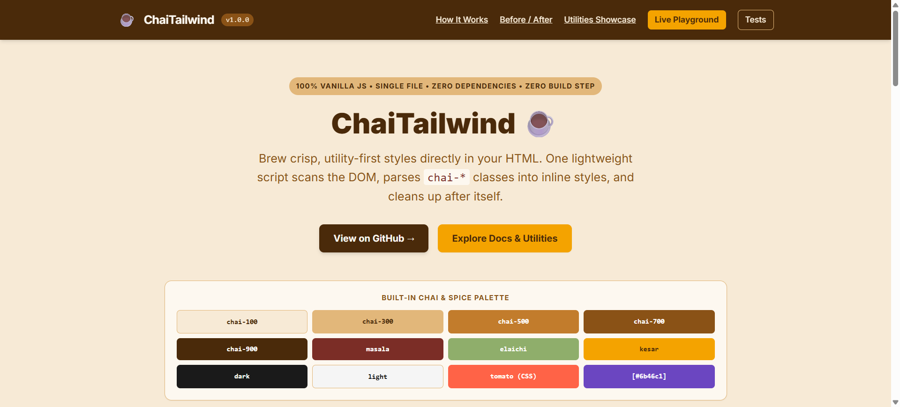

# ChaiTailwind ☕

> A lightweight, zero-dependency, zero-build utility-first CSS engine written in vanilla JavaScript that transforms `chai-*` HTML classes directly into inline styles.

- **Live Demo:** [https://your-username.github.io/chai-tailwind/](https://your-username.github.io/chai-tailwind/)
- **Interactive Playground:** [playground.html](./playground.html)
- **Acceptance Test Suite:** [tests.html](./tests.html)



---

## Quick Start

Drop a single `<script>` tag at the end of your `<body>`. No npm install, no bundler, and no CSS files required:

```html
<div class="chai-p-16 chai-bg-tomato chai-text-white chai-rounded-8 chai-text-center">
  Hello Chai ☕
</div>

<script src="src/chai-tailwind.js"></script>
```

After `ChaiTailwind` runs, the element becomes:

```html
<div style="padding: 16px; background-color: tomato; color: white; border-radius: 8px; text-align: center;">
  Hello Chai ☕
</div>
```

---

## How It Works

ChaiTailwind operates in **5 deterministic steps** at runtime:

1. **Traverse:** Queries `root` and all descendants matching `[class*="chai-"]` on `DOMContentLoaded` (or immediately if the DOM is already ready).
2. **Identify:** Copies each element's `classList` into a static array, filtering for `chai-*` tokens while leaving non-`chai` classes (e.g., `card`) untouched.
3. **Parse:** Matches each token against the `KEYWORDS` map first, then performs a longest-prefix lookup in the `UTILITIES` registry and resolves its value (`spacing`, `color`, `size`, `text`, etc.), caching results in a `Map`.
4. **Apply:** Sets inline styles on `element.style` in class order so later classes naturally override earlier ones (`chai-p-4 chai-p-8` → `padding: 8px`).
5. **Remove:** Strips processed `chai-*` classes from `element.classList` (and removes the `class` attribute altogether if empty), leaving unknown classes in place.

---

## Supported Utilities

| Category | Utility Examples | Generated Inline Style |
|---|---|---|
| **Spacing** | `chai-p-16`, `chai-px-12`, `chai-py-8`, `chai-pt-4`, `chai-m-0`, `chai-mx-auto`, `chai--m-8`, `chai-gap-16` | `padding`, `margin` (supports `auto` & negative `chai--m-*`), `gap` in `px` |
| **Sizing** | `chai-w-200`, `chai-w-full`, `chai-w-1/2`, `chai-h-screen`, `chai-min-w-100`, `chai-max-w-960` | `width`, `height`, `min/max-width`, `min/max-height` (`px`, `100%`, `100vh`/`100vw`, `auto`, fractions) |
| **Colors** | `chai-bg-red`, `chai-bg-chai-500`, `chai-text-kesar`, `chai-border-masala` | `background-color`, `color`, `border-color` (CSS named colors + built-in Chai palette) |
| **Typography** | `chai-text-24`, `chai-text-xl`, `chai-text-center`, `chai-font-bold`, `chai-font-700`, `chai-font-mono`, `chai-bold`, `chai-italic`, `chai-underline`, `chai-no-underline`, `chai-uppercase`, `chai-leading-1.5`, `chai-tracking-2` | `font-size`, `text-align`, `font-weight`, `font-family`, `font-style`, `text-decoration`, `text-transform`, `line-height`, `letter-spacing` |
| **Borders & Radius** | `chai-border`, `chai-border-2`, `chai-border-t-1`, `chai-border-dashed`, `chai-rounded`, `chai-rounded-12`, `chai-rounded-full`, `chai-rounded-tl-8` | `border`, `border-width`, `border-style`, `border-radius`, corner radii |
| **Layout** | `chai-flex`, `chai-grid`, `chai-block`, `chai-hidden`, `chai-flex-col`, `chai-items-center`, `chai-justify-between`, `chai-flex-1`, `chai-grid-cols-3`, `chai-relative`, `chai-sticky`, `chai-top-0`, `chai-z-10`, `chai-overflow-hidden` | `display`, `flex-direction`, `align-items`, `justify-content`, `flex`, `grid-template-columns`, `position`, offsets, `z-index`, `overflow` |
| **Effects** | `chai-shadow`, `chai-shadow-sm/md/lg/xl`, `chai-opacity-75`, `chai-cursor-pointer`, `chai-transition` | `box-shadow`, `opacity` (`0..1`), `cursor`, `transition` |

### Built-in Chai Palette

| Token | Hex | Token | Hex |
|---|---|---|---|
| `chai-50` | `#fdf8f0` | `masala` | `#7b2d26` |
| `chai-100` | `#f7ead6` | `elaichi` | `#8fae6b` |
| `chai-300` | `#e2b77a` | `kesar` | `#f4a300` |
| `chai-500` | `#c27c2c` | `dark` | `#1a1a1a` |
| `chai-700` | `#8a5216` | `light` | `#f5f5f5` |
| `chai-900` | `#4a2a0a` | | |

---

## Arbitrary Values (`[...]`)

Need a custom unit, hex color, or CSS expression? Wrap the value in square brackets `[...]`. Underscores (`_`) inside brackets are automatically converted to spaces:

- `chai-bg-[#ff6600]` → `background-color: #ff6600`
- `chai-p-[1.5rem]` → `padding: 1.5rem`
- `chai-w-[calc(100%_-_28px)]` → `width: calc(100% - 28px)`
- `chai-border-[1px_solid_red]` → `border: 1px solid red`
- `chai-grid-cols-[repeat(auto-fit,minmax(220px,1fr))]` → `grid-template-columns: repeat(auto-fit, minmax(220px, 1fr))`

---

## Public API

`window.ChaiTailwind` exposes:

```js
// Scan root + descendants, apply inline styles, return number of classes processed
ChaiTailwind.apply(root = document.body);

// Pure function: parse a single class into a style object (or null if unknown)
ChaiTailwind.parse('chai-p-12'); // → { padding: '12px' }

// Start a MutationObserver to automatically style elements/classes added dynamically
ChaiTailwind.observe(root = document.body);

// Configure debug warnings and class retention
ChaiTailwind.config({ debug: true, keepClasses: false });

// Engine version
ChaiTailwind.version; // '1.0.0'
```

To disable automatic execution on page load, add `data-chai-manual` to the script tag:

```html
<script src="src/chai-tailwind.js" data-chai-manual></script>
```

---

## Limitations

Because ChaiTailwind applies styles directly to `element.style` (inline styles) in class order without generating or injecting a `<style>` sheet:
- **No pseudo-classes:** `hover:`, `focus:`, `active:`, and `::before`/`::after` cannot be expressed in inline styles.
- **No media queries / responsive prefixes:** Breakpoint prefixes like `sm:`, `md:`, `lg:`, or `dark:` are not supported via inline `style` attributes (use CSS Grid `auto-fit` bracket values like `chai-grid-cols-[repeat(auto-fit,minmax(220px,1fr))]` for responsive layouts).
- **Shorthand class ordering (`chai-border`):** Because classes are applied in order and `chai-border` sets the shorthand `border: 1px solid currentColor`, place `chai-border` *before* color or style overrides (e.g., `chai-border chai-border-red`, not `chai-border-red chai-border`).

---

## Run Locally

1. **Direct file open:** Double-click `index.html`, `playground.html`, or `tests.html` to open directly in any modern browser (`file://` works out of the box).
2. **Local static server (optional):**
   ```bash
   npx serve .
   ```

---

## Deploy

Because there is no build step or dependency tree, deploy the repository root directly to any static host:
- **GitHub Pages:** Settings → Pages → Deploy from branch (`main` / `/root`).
- **Vercel / Netlify:** Import repository with Build Command left empty and Output Directory set to `.`.

